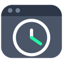
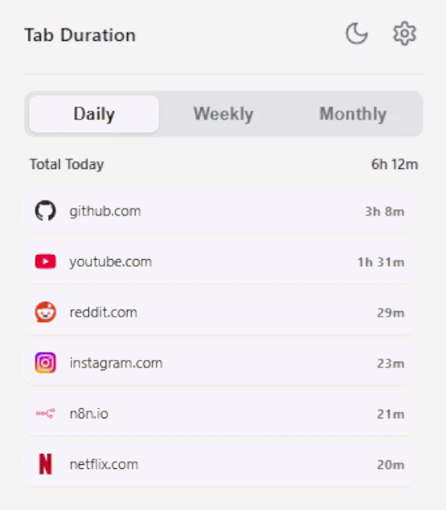

  

<h1 align="center">Tab Duration</h1>

An extension to track your browsing time, Tab Duration offers daily, weekly, and monthly insights to help you understand your online habits. Browsing time and settings are stored locally on your device.

## Preview

## Features

- **Automatic Time Tracking**: Tracks time spent on active tabs without any manual input.
- **Multiple Views**:
    - **Daily**: See a breakdown of sites visited today.
    - **Weekly**: Get a summary of time spent each day of the current week.
    - **Monthly**: See your daily totals for the entire current month.
- **Detailed Drill-Down**: Click on any day in the weekly or monthly view to see the specific site data for that day.
- **Dark & Light Mode**: Switch between themes based on your preference.
- **Website Lists**: Ignore specific sites, or turn off Track All Web to track only sites on your optional whitelist.
- **Data Management**:
    - **Export to CSV**: Download your browsing time history as a CSV file for viewing and analyzing in Excel.
    - **Reset Data**: Clear all tracked data easily.
- **Pause When Inactive**: Optional setting that pauses tracking after 60 seconds without user activity.
- **Zero Dependencies**: Built with vanilla JavaScript, HTML, and CSS.

## Installation

**Microsoft Edge:** [Install from Microsoft Edge Add-ons](https://microsoftedge.microsoft.com/addons/detail/ifonpipddgdilpjcdjialpjbfknnlcjf)

### Manual Installation

1.  **Download the Extension:** Choose the ZIP for your browser from the [GitHub Releases page](https://github.com/AdityaLF/Tab-Duration/releases).
2.  **Extract the ZIP file.**

### Loading the Extension

After extracting the ZIP, follow the steps for your browser.

#### Chrome, Brave, and Microsoft Edge

1.  **Open the Extensions Page:**
    * In **Chrome** or **Brave**, navigate to `chrome://extensions`
    * In **Microsoft Edge**, navigate to `edge://extensions`

2.  **Enable Developer Mode:** Find the "Developer mode" toggle and turn it on.

3.  **Load the Extension:**
    * Click the **"Load unpacked"** button.
    * Select the folder where you extracted the ZIP.

The Tab-Duration icon will now appear in your browser's toolbar.

## Privacy

Read the [Privacy Policy](./PRIVACY_POLICY.md) for information about local data storage, favicon requests, and data retention.

## License

Tab Duration is licensed under the [MIT License](./LICENSE).
